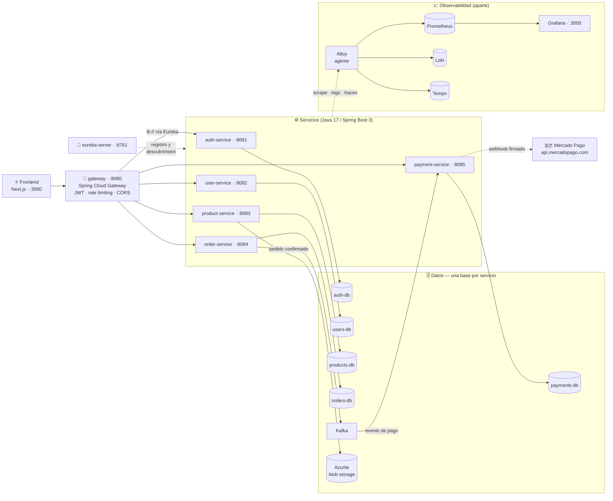

<div align="center">

# 🛒 La Tiendita — Microservicios en Kubernetes

**E-commerce de ejemplo construido como arquitectura de microservicios.**

Seis servicios Java 17 / Spring Boot 3 con una base de datos propia cada uno, Kafka para los eventos asíncronos, un único punto de entrada con gateway y frontend en Next.js.
El mismo stack corre en **local con Docker Compose** y en **Kubernetes (kind) con Kustomize**, con la observabilidad (métricas, logs y traces) cableada desde el día uno.

[**Arquitectura**](#-arquitectura) · [**Levantarlo**](#-puesta-en-marcha-local-docker-compose) · [**API**](#-api-principal) · [**Kubernetes**](#-kubernetes) · [**Scripts**](#-scripts) · [**Docs**](#-documentación)


</div>

---

## ✨ ¿Qué es?

Un backend de tienda real, dividido en microservicios, pensado para practicar **arquitectura distribuida de punta a punta**: no es sólo "un CRUD por servicio", sino que incluye lo que siempre hace falta en producción — autenticación con JWT, rate limiting, eventos con Kafka, webhooks firmados, storage de imágenes, políticas de red y una pila de observabilidad completa.

| | Qué incluye |
|---|---|
| 🔐 | **Auth con JWT** — registro y login en `auth-service`; el gateway valida la firma y propaga el usuario. Rate limiting más estricto en `/api/auth/**`. |
| 🛍️ | **Catálogo** — productos y categorías con su propia DB, más las fotos subidas a blob storage (Azurite en local, Azure Blob Storage en producción) y servidas por proxy desde el backend: el navegador nunca habla directo con el storage. |
| 🧾 | **Pedidos** — alta, consulta y ciclo de estado (`PENDING` → `PAID`) disparado por el evento de pago. |
| 💳 | **Pagos con Mercado Pago** — preferencias de checkout, webhook con firma `x-signature` validada y resolución del pago por `external_reference`. Sin credenciales el servicio arranca igual y devuelve `503`. |
| 🌐 | **Gateway único** — Spring Cloud Gateway con ruteo por prefijo `/api/**`, JWT, CORS, límite de tamaño de request y rate limiting por ruta. |
| 🔍 | **Observabilidad** — Prometheus (métricas `/actuator/prometheus`), Loki (logs JSON), Tempo (traces OTLP) y Grafana, con Alloy como agente. |

---

## 🏗️ Arquitectura



**Dos decisiones de diseño que se mantienen en ambos entornos:**

- **Cada servicio es dueño de su base.** Nadie toca la tabla de otro: la comunicación entre servicios es por API (síncrono) o por Kafka (asíncrono).
- **En Kubernetes no hay Eureka.** Los servicios se descubren por DNS del clúster (`http://auth-service`) y el gateway apunta a URLs directas; Eureka sólo aplica a desarrollo local con Compose.

### Servicios y puertos (local)

| Servicio | Puerto | Responsabilidad | Base de datos |
|---|---|---|---|
| `gateway` | `8080` | Puerta de entrada única: rutea `/api/**`, valida JWT, CORS y rate limiting | — |
| `auth-service` | `8081` | Registro, login y emisión de JWT | `auth-db` |
| `user-service` | `8082` | Perfiles de usuario | `users-db` |
| `product-service` | `8083` | Catálogo (productos/categorías) e imágenes de los productos | `products-db` |
| `order-service` | `8084` | Pedidos y su estado | `orders-db` |
| `payment-service` | `8085` | Pagos con Mercado Pago y su webhook | `payments-db` |
| `eureka-server` | `8761` | Registro y descubrimiento (sólo Compose) | — |
| `frontend` | `3000` | SPA Next.js | — |
| `kafka` | interno | Eventos entre servicios (pedido → pago) | — |
| `azurite` | interno | Emulador de Azure Blob Storage: fotos del catálogo | — |

Con el profile `tools` aparecen además **kafka-ui** (`:8090`) y **pgAdmin** (`:5050`).

---

## 📂 Estructura del monorepo

```
├── services/                    ⚙️  6 microservicios + eureka-server + gateway
│   ├── auth-service/            🔐  JWT, registro y login
│   ├── user-service/            👤  perfiles
│   ├── product-service/         🛍️  catálogo + storage de imágenes + seed
│   ├── order-service/           🧾  pedidos
│   ├── payment-service/         💳  Mercado Pago (webhook firmado)
│   ├── gateway/                 🚪  Spring Cloud Gateway
│   └── eureka-server/           🧭  descubrimiento (sólo Compose)
├── frontend/                    ⚛️  Next.js: catálogo, checkout y retorno de MP
├── k8s/
│   ├── apps/                    6 servicios + frontend (base + local/production)
│   ├── data/                    Postgres ×5 + Kafka + Azurite (sólo local)
│   └── observability/           Prometheus, Loki, Tempo, Grafana, Alloy, Alertmanager
├── config/observability/        📈  configs compartidas (Docker y k8s)
├── scripts/                     🧰  automatización (bash y PowerShell)
├── docs/                        📚  microservicios, kubernetes y variables de entorno
├── terraform/                   🏗️  IaC del clúster (pendiente)
├── compose.yaml                 🐘  stack base
├── compose.override.yaml        🐘  puertos en el host + tools (dev)
└── compose.observability.yaml   🐘  pila de observabilidad (overlay)
```

---

## 🚀 Puesta en marcha local (Docker Compose)

**Requisitos:** [Docker Desktop](https://www.docker.com/products/docker-desktop/) (o Docker Engine + plugin Compose v2), unos **4 GB de RAM libres** y Git.

```bash
git clone https://github.com/Damianpiazz/Kubernetes.git
cd Kubernetes

cp .env.example .env      # passwords de dev, JWT secret y credenciales de MP
docker compose up -d --build

docker compose ps         # todo debería quedar "healthy"
```

| URL | Qué es |
|---|---|
| http://localhost:3000 | Frontend (Next.js) |
| http://localhost:8080/api/... | API pública (vía gateway) |
| http://localhost:8761 | Eureka — panel de servicios registrados |
| http://localhost:808X/swagger-ui.html | Swagger de cada servicio (`X` = 1…5) |

Útiles del día a día:

```bash
docker compose logs -f product-service     # logs de un servicio
docker compose --profile tools up -d       # kafka-ui (:8090) y pgAdmin (:5050)
docker compose down                        # para todo (los datos quedan en volúmenes)
docker compose down -v                     # arrasa también los volúmenes: DBs, Azurite y Kafka
```

### 🖼️ Imágenes de productos (Azurite)

`product-service` guarda las fotos en blob storage. En local eso es **Azurite**, el emulador oficial de Microsoft, y el seed sube `seed/images/<SKU>.*` con clave determinística `productos/<SKU>.<ext>` en cada arranque (si limpiás el volumen, se reparan solas). La clave del emulador es un valor fijo y público que ya viene en `compose.yaml`; sólo hace falta tocar `AZURE_STORAGE_KEY` en `.env` si apuntás a una cuenta real de Azure Blob Storage.

### 💳 Mercado Pago en local

Sin `MERCADO_PAGO_ACCESS_TOKEN` el stack arranca igual, pero crear un pago responde `503`. Para probar el flujo completo hacen falta tres cosas: el token de prueba, el `MERCADO_PAGO_WEBHOOK_SECRET` y **un túnel público** (ngrok o cloudflared) — Mercado Pago rechaza `localhost` tanto en `notification_url` como en las `back_urls`. El detalle está en [docs/environment/enviroment.md](./docs/environment/enviroment.md#pago-con-mercado-pago-en-local-túnel).

---

## 🔌 API principal

Todo entra por el gateway (`:8080`) y el resto de los servicios no se publican en internet:

| Ruta | Servicio | Notas |
|---|---|---|
| `/api/auth/**` | `auth-service` | `POST /api/auth/register`, `POST /api/auth/login` |
| `/api/users/**` | `user-service` | perfil del usuario autenticado |
| `/api/products/**`, `/api/categories/**` | `product-service` | catálogo; `GET /api/products/{id}/image` sirve la foto |
| `/api/orders/**` | `order-service` | alta y consulta de pedidos |
| `/api/payments/**` | `payment-service` | crea el pago y devuelve la URL de checkout |
| `/api/webhooks/**` | `payment-service` | notificaciones de Mercado Pago (sin auth, con firma) |

Los endpoints exactos, los códigos de error y los contratos están en la documentación de [cada microservicio](#-documentación).

---

## ☸️ Kubernetes

El clúster local se arma con [kind](https://kind.sigs.k8s.io/) (o k3d) y tres stacks separados:

| Stack | Contenido | Namespace |
|---|---|---|
| `k8s/apps` | Los 6 servicios + frontend, con `base/` y overlays `local/` y `production/` | `latiendita` |
| `k8s/data` | 5 × Postgres + Kafka + Azurite — **sólo local**; en producción son servicios gestionados | `latiendita` |
| `k8s/observability` | Prometheus, Loki, Tempo, Grafana, Alloy y Alertmanager | `latiendita-observability` |

```bash
bash scripts/install-tools.sh    # verifica docker, kubectl y kind
bash scripts/secrets.sh          # genera secrets.env desde los .example
bash scripts/kind-up.sh          # clúster + build de imágenes + manifests

bash scripts/deploy.sh           # reaplica cambios (idempotente)
bash scripts/kind-down.sh        # baja el clúster
```

Cada script existe también en PowerShell (`.ps1`), con las mismas opciones. En local los pods se comunican detrás de **NetworkPolicies** con deny por defecto (por ejemplo, sólo `product-service` puede hablar con `azurite:10000`).

> ⚠️ El environment de producción todavía tiene valores `CHANGE-ME` pendientes (registry, ingress, endpoints de DB/Kafka y de Azure Blob Storage). El detalle está en [docs/kubernetes/configuracion.md](./docs/kubernetes/configuracion.md).

---

## 🔍 Observabilidad

Además del stack base, `compose.observability.yaml` levanta la pila completa:

| Componente | Rol |
|---|---|
| **Prometheus** | Scrapea `/actuator/prometheus` de todos los servicios |
| **Loki** | Recibe los logs JSON (formato logstash) de cada servicio |
| **Tempo** | Guarda los traces OTLP (muestreo configurable con `TRACING_SAMPLING_PROBABILITY`) |
| **Alloy** | Agente que junta métricas, logs y traces de los contenedores |
| **Grafana** | Los dashboards, en http://localhost:3000 (`admin` / `admin`) |
| **Alertmanager** | Destino de las alertas de Prometheus |

```bash
docker compose -f compose.yaml -f compose.override.yaml -f compose.observability.yaml up -d
```

> ⚠️ **Grafana y el frontend compiten por el puerto 3000**: si querés entrar a Grafana, pará el frontend con `docker compose stop frontend` (o cambiá el mapeo en `compose.observability.yaml`).

---

## 🧰 Scripts

Todos viven en [`scripts/`](./scripts/README.md) y vienen en dos versiones equivalentes — **bash** (`.sh`) y **PowerShell** (`.ps1` ≥ 5.1) — con los mismos parámetros y la misma salida en español.

| Script | Qué hace |
|---|---|
| `install-tools` | Verifica (e instala) Docker, kubectl y kind |
| `secrets` | Genera `.env` y `secrets.env` con valores fuertes desde los `.example` |
| `kind-up` | Levanta el entorno local completo sobre kind |
| `kind-down` | Limpia el clúster kind, sus imágenes y sus volúmenes |
| `build-images` | Construye las imágenes Docker de los servicios |
| `deploy` | Aplica los manifests de Kubernetes de forma idempotente |

Orden para arrancar desde cero: `install-tools` → `secrets` → `kind-up`.

---

## ⚙️ Variables de entorno

El stack local lee `.env` (creado desde `.env.example`); en Kubernetes el equivalente son los `secrets.env` de cada environment (creados desde sus `.example`). **Nunca se commitea ningún `.env`.**

| Variable | Dónde | Qué hace |
|---|---|---|
| `AUTH_DB_PASSWORD` … `PAYMENTS_DB_PASSWORD` | `.env` | Passwords de las 5 instancias de Postgres |
| `JWT_SECRET` | `.env` | Firma de los tokens; si no coincide entre auth y gateway, todo devuelve 401 |
| `MERCADO_PAGO_ACCESS_TOKEN` | `.env` | Vacío ⇒ integración de pagos deshabilitada |
| `MERCADO_PAGO_WEBHOOK_SECRET` | `.env` | Valida la firma `x-signature` de los webhooks; vacío ⇒ notificaciones ignoradas |
| `MERCADO_PAGO_NOTIFICATION_URL` / `MERCADO_PAGO_BACK_URL_*` | `.env` | URL pública del webhook y de retorno (túnel en local) |
| `AZURE_STORAGE_KEY` | `.env` (opcional) | Sobreescribe la clave de Azurite; sólo si se usa otro storage |
| `GRAFANA_ADMIN_USER` / `GRAFANA_ADMIN_PASSWORD` | `.env` | Credenciales de Grafana |

La tabla completa (incluidas las variables de Kubernetes) está en [docs/environment/enviroment.md](./docs/environment/enviroment.md).

---

## 📚 Documentación

| Documento | Contenido |
|---|---|
| [docs/microservicios/auth.md](./docs/microservicios/auth.md) | Registro, login y JWT |
| [docs/microservicios/user.md](./docs/microservicios/user.md) | Perfiles de usuario |
| [docs/microservicios/product.md](./docs/microservicios/product.md) | Catálogo, imágenes y seed |
| [docs/microservicios/order.md](./docs/microservicios/order.md) | Pedidos y su máquina de estados |
| [docs/microservicios/payment.md](./docs/microservicios/payment.md) | Pagos y webhook de Mercado Pago |
| [docs/mercado-pago/mercado-pago.md](./docs/mercado-pago/mercado-pago.md) | Puertos, URLs públicas y túnel/exposición por entorno |
| [docs/microservicios/gateway.md](./docs/microservicios/gateway.md) · [eureka-server.md](./docs/microservicios/eureka-server.md) | Ruteo, JWT, CORS, rate limiting y descubrimiento |
| [docs/kubernetes/configuracion.md](./docs/kubernetes/configuracion.md) | Diseño del despliegue en k8s (§12 = pendientes de producción) |
| [docs/kubernetes/comandos.md](./docs/kubernetes/comandos.md) · [red.md](./docs/kubernetes/red.md) | Comandos de rutina y diseño de red/NetworkPolicies |
| [docs/environment/enviroment.md](./docs/environment/enviroment.md) | Todas las variables de entorno (Compose y k8s) |
| [scripts/README.md](./scripts/README.md) | Uso detallado de cada script |

---

<div align="center">

**La Tiendita** · arquitectura de microservicios de punta a punta

*Spring Boot, Kafka, Kubernetes — y bastante café.*

[Repositorio](https://github.com/Damianpiazz/Kubernetes)

</div>
